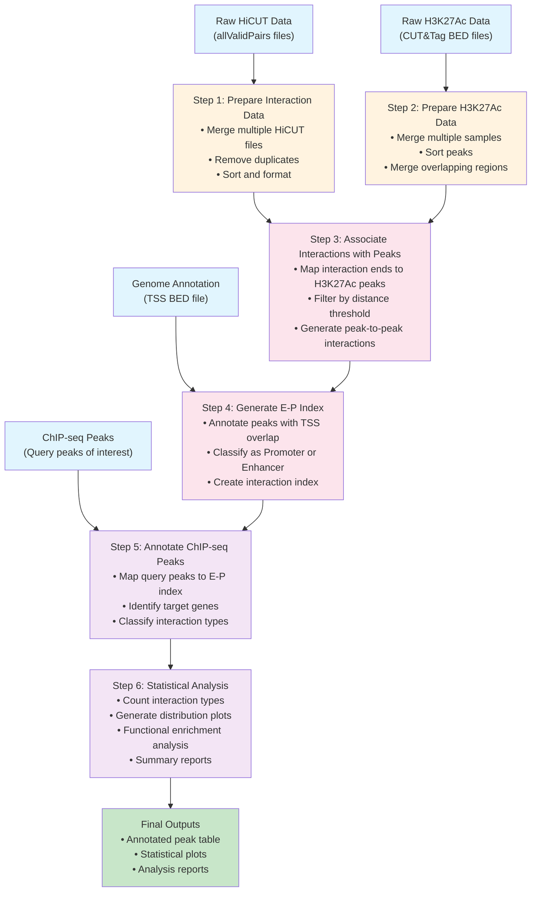

# EP_annotator

EP_annotator is a bioinformatics tool for annotating enhancer-promoter (EP) interactions using Hi-C and CUT&Tag data.

## Description

This tool integrates chromatin interaction data (Hi-C) with histone modification signals (CUT&Tag) to identify and annotate enhancer-promoter interactions in the genome. It provides comprehensive analysis capabilities for understanding regulatory landscapes in mammalian genomes.

## Features

- Integration of Hi-C chromatin interaction data
- CUT&Tag histone modification signal analysis
- Peak annotation with genomic features
- Enhancer-promoter interaction mapping
- Support for mouse genome (mm10)

## Workflow

The EP_annotator follows a systematic 6-step workflow to process raw data and generate comprehensive EP interaction annotations:



### Workflow Steps Explained

1. **Prepare Interaction Data**: Process raw HiCUT chromatin interaction files by merging replicates, removing duplicates, and standardizing format
2. **Prepare H3K27Ac Data**: Consolidate CUT&Tag histone modification data from multiple samples and merge overlapping peaks
3. **Associate Interactions with Peaks**: Map chromatin interaction endpoints to active histone modification sites and filter by distance
4. **Generate E-P Index**: Create enhancer-promoter interaction index by annotating peaks with transcription start sites (TSS)
5. **Annotate ChIP-seq Peaks**: Map user-provided ChIP-seq peaks to the E-P interaction index to identify target genes
6. **Statistical Analysis**: Generate comprehensive statistics, visualizations, and functional enrichment analyses

## Installation

### Prerequisites

Before installing EP_annotator, ensure you have the following system dependencies:

#### System Dependencies
```bash
# On Ubuntu/Debian
sudo apt-get update
sudo apt-get install bedtools gawk coreutils gzip

# On macOS (using Homebrew)
brew install bedtools gawk coreutils gzip

# On CentOS/RHEL
sudo yum install bedtools gawk coreutils gzip
```

#### Python Environment
```bash
# Create a conda environment (recommended)
conda create -n ep_annotator python=3.8
conda activate ep_annotator

# Or use virtual environment
python3 -m venv ep_annotator_env
source ep_annotator_env/bin/activate  # On Linux/macOS
# ep_annotator_env\Scripts\activate   # On Windows
```

### Install EP_annotator

```bash
# Clone the repository
git clone https://github.com/Badgerliu/EP_annotator.git
cd EP_annotator

# Install Python dependencies
pip install -r requirements.txt

# Install the package in development mode
pip install -e .
```

### Verify Installation

```bash
# Run the comprehensive verification script
python scripts/verify_installation.py

# Or check individual components:
# Test that bedtools is available
bedtools --version

# Test the Python installation
python -c "import ep_annotator; print('EP_annotator installed successfully!')"

# Run a quick test
python scripts/run_pipeline.py --help
```

## Requirements

### Python Dependencies

EP_annotator requires Python 3.7+ and the following packages:

#### Core Dependencies
- **pandas>=1.3.0**: Required for data processing across multiple steps (Steps 2, 3, 5, 6)
- **numpy>=1.21.0**: Required by pandas and for numerical operations
- **pybedtools>=0.9.0**: Required for genomic interval operations (Steps 3, 5)
- **intervaltree>=3.0.0**: Required for efficient interval operations (Steps 3, 4)
- **tqdm>=4.60.0**: Required for progress bars in annotation steps (Step 4)
- **PyYAML>=5.4.0**: For configuration file parsing

#### Visualization and Analysis Dependencies
- **matplotlib>=3.4.0**: For generating plots and statistical visualizations (Steps 5, 6)
- **seaborn>=0.11.0**: For enhanced statistical plots and data visualization (Steps 5, 6)
- **scipy>=1.7.0**: For advanced statistical analysis (Step 6, optional)

#### Development and Testing Dependencies
- **pytest>=6.0.0**: For unit testing
- **black>=21.0.0**: For code formatting
- **flake8>=3.9.0**: For code linting
- **jupyter>=1.0.0**: For interactive analysis and development (optional)

### System Dependencies

The following system tools are required and must be installed separately:

- **bedtools**: Required for Step 2 (peak processing) and Step 3 (peak annotation)
- **awk/gawk**: Required for Step 1 and Step 2 (data preprocessing)
- **sort**: Required for Step 1 and Step 2 (data sorting)
- **gzip/gunzip**: Required for compressed file handling

## Usage

### Quick Start with Test Data

EP_annotator comes with sample data for testing and validation. **Before using your own data, we strongly recommend running the test pipeline to understand the complete workflow.**

#### 🎯 Recommended First Steps

```bash
# 1. FIRST: Study the example configuration and script
cat test_data/test_config.yaml     # Understand configuration structure
cat test_data/run_test.sh          # See complete pipeline execution

# 2. Run the complete test pipeline
bash test_data/run_test.sh

# 3. Alternative: Run step by step with verbose output
python scripts/run_pipeline.py -c test_data/test_config.yaml -v

# Expected runtime: 2-5 minutes
# Expected output: 16 files including data, reports, and visualizations
```

#### 📊 Test Data Contents

The test data includes:
- **3.3M Hi-C interactions** (~93MB) - Real experimental data
- **219K H3K27Ac peaks** (~5MB) - CUT&Tag peaks from mouse tissue
- **1K query peaks** for annotation - Sample ChIP-seq peaks
- **Complete configuration** (`test_config.yaml`) - Template for your projects
- **Automated test script** (`run_test.sh`) - Complete pipeline example

#### 📖 Essential Reading

- **`test_data/test_config.yaml`** - Configuration file template with comments
- **`test_data/run_test.sh`** - Complete pipeline execution example  
- **`test_data/README.md`** - Detailed testing instructions and expected results
- **`test_output/PIPELINE_TEST_SUMMARY.md`** - Complete test results (generated after running)

**💡 Pro Tip**: Use these test files as templates for your own analysis!

### Using Your Own Data

```bash
# Copy and modify the example configuration
cp config/example_config.yaml my_config.yaml
# Edit my_config.yaml with your file paths

# Run the complete pipeline
python scripts/run_pipeline.py -c my_config.yaml

# Or run individual steps
python scripts/run_pipeline.py -c my_config.yaml -s 1  # Step 1 only
```

### Complete Pipeline Execution

EP_annotator provides multiple ways to run the complete 6-step pipeline. For first-time users, we recommend examining the test configuration and script as examples.

#### 📚 Learning from Examples

Before running your own data, please review these example files:

```bash
# 1. Examine the test configuration file
cat test_data/test_config.yaml

# 2. Study the complete pipeline test script
cat test_data/run_test.sh

# 3. Run the example to understand the workflow
./test_data/run_test.sh
```

These files demonstrate:
- **Configuration structure**: How to organize input/output paths and parameters
- **Pipeline execution**: Complete Steps 1-6 with real data
- **Expected outputs**: What files are generated at each step
- **Performance benchmarks**: Typical runtime and resource usage

#### 🚀 Running Your Complete Pipeline

**Method 1: Configuration File Approach (Recommended)**

```bash
# 1. Create your configuration file based on the example
cp test_data/test_config.yaml my_project_config.yaml

# 2. Edit the configuration with your data paths
nano my_project_config.yaml  # or use your preferred editor

# 3. Run the complete pipeline (Steps 1-6)
python scripts/run_pipeline.py -c my_project_config.yaml -v

# Expected runtime: 2-10 minutes depending on data size
# Output: 15+ files including data, annotations, and visualizations
```

**Method 2: Command Line with Individual Steps**

```bash
# Run each step individually for debugging or custom workflows
python scripts/run_pipeline.py -c my_config.yaml -s 1 -v  # Prepare interactions
python scripts/run_pipeline.py -c my_config.yaml -s 2 -v  # Prepare peaks  
python scripts/run_pipeline.py -c my_config.yaml -s 3 -v  # Associate peaks
python scripts/run_pipeline.py -c my_config.yaml -s 4 -v  # Generate E-P index
python scripts/run_pipeline.py -c my_config.yaml -s 5 -v  # Annotate query peaks
python scripts/run_pipeline.py -c my_config.yaml -s 6 -v  # Statistical analysis
```

#### 📋 Configuration File Structure

Your configuration file should include the following sections:

```yaml
# Input files
input:
  hicut_pairs:                    # List of Hi-C interaction files
    - "data/sample1.allValidPairs"
    - "data/sample2.allValidPairs"
  active_peaks:                   # List of H3K27Ac peak files
    - "data/sample1_H3K27ac.bed"
    - "data/sample2_H3K27ac.bed"
  tss_bed: "refGenome/mm10/mm10_NCBIRefSeq_refGene.bed"  # TSS annotation
  query_peaks: "data/my_chipseq_peaks.bed"              # Your ChIP-seq peaks

# Output settings
output:
  prefix: "my_experiment"         # Output file prefix
  directory: "results"            # Output directory

# Step-specific parameters (optional)
step3:
  distance_threshold: 2000        # Distance threshold for peak association
step4:
  promoter_window: 1000          # TSS ±1kb for promoter definition
step6:
  plot_format: "png"             # Visualization format
```

#### 🔍 Pipeline Validation

After running your pipeline, validate the results:

```bash
# Check output directory
ls -la results/

# Verify core output files exist:
# - {prefix}_interactions.bedpe          # Step 1 output
# - {prefix}_peaks.bed                   # Step 2 output  
# - {prefix}_associated.bedpe            # Step 3 output
# - {prefix}_index.bedpe.gz              # Step 4 output
# - {prefix}_peak_annotation.tsv         # Step 5 output
# - {prefix}_comprehensive_statistics.txt # Step 6 output

# View summary statistics
head -20 results/my_experiment_comprehensive_statistics.txt

# Check visualization plots
ls results/*.png
```

#### ⚡ Performance Tips

- **Memory**: Allocate 8-16GB RAM for large datasets (>1M interactions)
- **Storage**: Ensure 2-5x input data size for temporary and output files
- **CPU**: The pipeline benefits from multi-core systems (Steps 3-4)
- **Time**: Typical runtime is 2-10 minutes for datasets <5M interactions

#### 🚨 Troubleshooting

If the pipeline fails:

```bash
# 1. Check system dependencies
bedtools --version
python -c "import pandas, pybedtools; print('Dependencies OK')"

# 2. Validate input file formats
head -5 your_hicut_file.allValidPairs
head -5 your_peaks.bed

# 3. Run with verbose output for debugging
python scripts/run_pipeline.py -c my_config.yaml -v

# 4. Test with smaller datasets first
# 5. Check log messages for specific error details
```

### Python API Usage

```python
from ep_annotator.step1_prepare_interactions import prepare_interactions
from ep_annotator.step2_prepare_peaks import prepare_peaks

# Step 1: Prepare HiCUT interaction data
hicut_files = ["sample1.allValidPairs", "sample2.allValidPairs"]
interactions = prepare_interactions(hicut_files, "my_experiment")

# Step 2: Prepare H3K27Ac peak data  
peak_files = ["sample1_H3K27ac.bed", "sample2_H3K27ac.bed"]
peaks = prepare_peaks(peak_files, "my_experiment")
```

## Input Data

The tool works with the following data types:

### Required Input Files
- **Hi-C interaction files** (`.allValidPairs`): Raw chromatin interaction data from HiC-Pro or similar tools
- **CUT&Tag peak files** (`.bed`): H3K27Ac histone modification peaks in BED format
- **Reference genome annotations** (`.bed`): TSS annotations (e.g., from UCSC RefSeq)
- **Query ChIP-seq peaks** (`.bed`): Peaks of transcription factors of interest

### Supported Genomes
- Mouse genome (mm10) - fully supported
- Other genomes can be used with appropriate annotation files

## Output

The pipeline generates the following outputs:

- **Interaction index** (`.bedpe.gz`): Annotated enhancer-promoter interaction database
- **Peak annotations** (`.tsv`): Detailed annotations for query peaks with target genes
- **Statistical plots** (`.pdf/.png`): Visualization of interaction types and distributions
- **Summary reports**: Quantitative analysis of enhancer-promoter interactions

## Contributing

Contributions are welcome! Please feel free to submit a Pull Request.

## License

This project is licensed under the MIT License - see the [LICENSE](LICENSE) file for details.

The MIT License allows for:
- ✅ Commercial use
- ✅ Modification
- ✅ Distribution
- ✅ Private use

Only requires:
- 📄 License and copyright notice

## Contact

For questions and support, please contact: liu.huand@gmail.com

## Development Status

🚧 This project is currently under active development. 