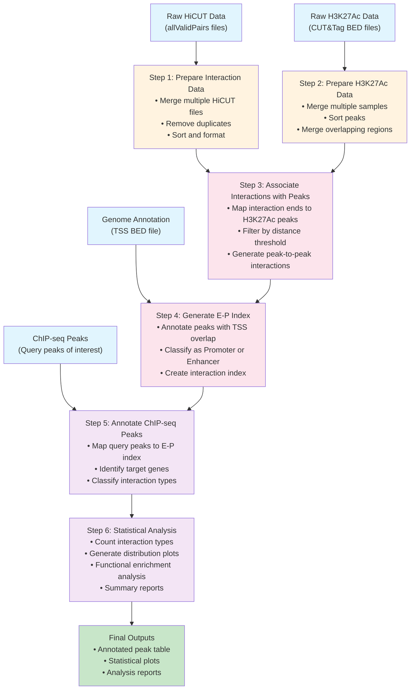

# EP_annotator

EP_annotator is a bioinformatics tool for annotating enhancer-promoter (EP) interactions using Hi-C and CUT&Tag data.

## Description

This tool integrates chromatin interaction data (Hi-C) with histone modification signals (CUT&Tag) to identify and annotate enhancer-promoter interactions in the genome. It provides comprehensive analysis capabilities for understanding regulatory landscapes in mammalian genomes.

## Features

- Integration of Hi-C chromatin interaction data
- CUT&Tag histone modification signal analysis
- Peak annotation with genomic features
- Enhancer-promoter interaction mapping
- Support for mouse genome (mm10)

## Workflow

The EP_annotator follows a systematic 6-step workflow to process raw data and generate comprehensive EP interaction annotations:



### Workflow Steps Explained

1. **Prepare Interaction Data**: Process raw HiCUT chromatin interaction files by merging replicates, removing duplicates, and standardizing format
2. **Prepare H3K27Ac Data**: Consolidate CUT&Tag histone modification data from multiple samples and merge overlapping peaks
3. **Associate Interactions with Peaks**: Map chromatin interaction endpoints to active histone modification sites and filter by distance
4. **Generate E-P Index**: Create enhancer-promoter interaction index by annotating peaks with transcription start sites (TSS)
5. **Annotate ChIP-seq Peaks**: Map user-provided ChIP-seq peaks to the E-P interaction index to identify target genes
6. **Statistical Analysis**: Generate comprehensive statistics, visualizations, and functional enrichment analyses

## Installation

### Prerequisites

Before installing EP_annotator, ensure you have the following system dependencies:

#### System Dependencies
```bash
# On Ubuntu/Debian
sudo apt-get update
sudo apt-get install bedtools gawk coreutils gzip

# On macOS (using Homebrew)
brew install bedtools gawk coreutils gzip

# On CentOS/RHEL
sudo yum install bedtools gawk coreutils gzip
```

#### Python Environment
```bash
# Create a conda environment (recommended)
conda create -n ep_annotator python=3.8
conda activate ep_annotator

# Or use virtual environment
python3 -m venv ep_annotator_env
source ep_annotator_env/bin/activate  # On Linux/macOS
# ep_annotator_env\Scripts\activate   # On Windows
```

### Install EP_annotator

```bash
# Clone the repository
git clone https://github.com/Badgerliu/EP_annotator.git
cd EP_annotator

# Install Python dependencies
pip install -r requirements.txt

# Install the package in development mode
pip install -e .
```

### Verify Installation

```bash
# Run the comprehensive verification script
python scripts/verify_installation.py

# Or check individual components:
# Test that bedtools is available
bedtools --version

# Test the Python installation
python -c "import ep_annotator; print('EP_annotator installed successfully!')"

# Run a quick test
python scripts/run_pipeline.py --help
```

## Requirements

### Python Dependencies

EP_annotator requires Python 3.7+ and the following packages:

#### Core Dependencies
- **pandas>=1.3.0**: Required for Step 2 pure Python implementation and data processing
- **numpy>=1.21.0**: Required by pandas and for numerical operations  
- **pybedtools>=0.9.0**: Required for Step 5 peak annotation
- **intervaltree>=3.0.0**: Required for Step 4 interval operations
- **tqdm>=4.60.0**: Required for progress bars in annotation steps
- **PyYAML>=5.4.0**: For configuration file parsing

#### Visualization Dependencies
- **matplotlib>=3.4.0**: For generating plots and statistical visualizations
- **seaborn>=0.11.0**: For enhanced statistical plots

#### Optional Dependencies
- **jupyter>=1.0.0**: For interactive analysis and development
- **scipy>=1.7.0**: For advanced statistical analysis

### System Dependencies

The following system tools are required and must be installed separately:

- **bedtools**: Required for Step 2 (peak processing) and Step 3 (peak annotation)
- **awk/gawk**: Required for Step 1 and Step 2 (data preprocessing)
- **sort**: Required for Step 1 and Step 2 (data sorting)
- **gzip/gunzip**: Required for compressed file handling

## Usage

### Quick Start

```bash
# Copy and modify the example configuration
cp config/example_config.yaml my_config.yaml
# Edit my_config.yaml with your file paths

# Run the complete pipeline
python scripts/run_pipeline.py -c my_config.yaml

# Or run individual steps
python scripts/run_pipeline.py -c my_config.yaml -s 1  # Step 1 only
```

### Python API Usage

```python
from ep_annotator.step1_prepare_interactions import prepare_interactions
from ep_annotator.step2_prepare_peaks import prepare_peaks

# Step 1: Prepare HiCUT interaction data
hicut_files = ["sample1.allValidPairs", "sample2.allValidPairs"]
interactions = prepare_interactions(hicut_files, "my_experiment")

# Step 2: Prepare H3K27Ac peak data  
peak_files = ["sample1_H3K27ac.bed", "sample2_H3K27ac.bed"]
peaks = prepare_peaks(peak_files, "my_experiment")
```

## Input Data

The tool works with the following data types:

### Required Input Files
- **Hi-C interaction files** (`.allValidPairs`): Raw chromatin interaction data from HiC-Pro or similar tools
- **CUT&Tag peak files** (`.bed`): H3K27Ac histone modification peaks in BED format
- **Reference genome annotations** (`.bed`): TSS annotations (e.g., from UCSC RefSeq)
- **Query ChIP-seq peaks** (`.bed`): Peaks of transcription factors of interest

### Supported Genomes
- Mouse genome (mm10) - fully supported
- Other genomes can be used with appropriate annotation files

## Output

The pipeline generates the following outputs:

- **Interaction index** (`.bedpe.gz`): Annotated enhancer-promoter interaction database
- **Peak annotations** (`.tsv`): Detailed annotations for query peaks with target genes
- **Statistical plots** (`.pdf/.png`): Visualization of interaction types and distributions
- **Summary reports**: Quantitative analysis of enhancer-promoter interactions

## Contributing

Contributions are welcome! Please feel free to submit a Pull Request.

## License

[License information to be added]

## Contact

For questions and support, please contact: liu.huand@gmail.com

## Development Status

🚧 This project is currently under active development. 