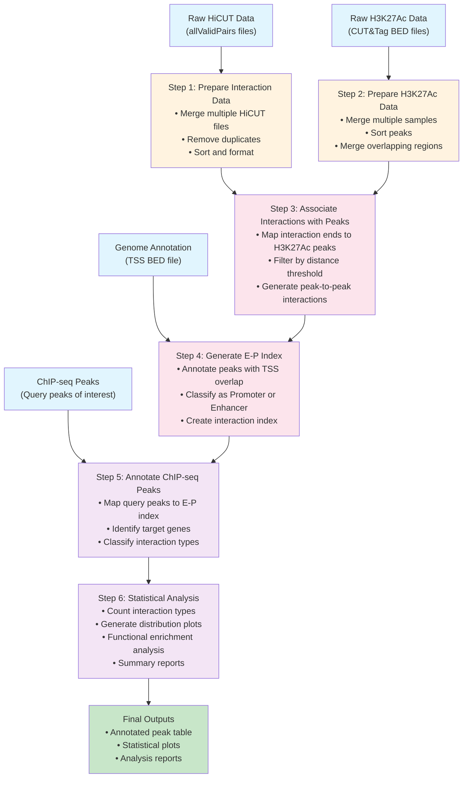

# EP_annotator

EP_annotator is a bioinformatics tool for annotating enhancer-promoter (EP) interactions using Hi-C and CUT&Tag data.

## Description

This tool integrates chromatin interaction data (Hi-C) with histone modification signals (CUT&Tag) to identify and annotate enhancer-promoter interactions in the genome. It provides comprehensive analysis capabilities for understanding regulatory landscapes in mammalian genomes.

## Features

- Integration of Hi-C chromatin interaction data
- CUT&Tag histone modification signal analysis
- Peak annotation with genomic features
- Enhancer-promoter interaction mapping
- Support for mouse genome (mm10)

## Workflow

The EP_annotator follows a systematic 6-step workflow to process raw data and generate comprehensive EP interaction annotations:



### Workflow Steps Explained

1. **Prepare Interaction Data**: Process raw HiCUT chromatin interaction files by merging replicates, removing duplicates, and standardizing format
2. **Prepare H3K27Ac Data**: Consolidate CUT&Tag histone modification data from multiple samples and merge overlapping peaks
3. **Associate Interactions with Peaks**: Map chromatin interaction endpoints to active histone modification sites and filter by distance
4. **Generate E-P Index**: Create enhancer-promoter interaction index by annotating peaks with transcription start sites (TSS)
5. **Annotate ChIP-seq Peaks**: Map user-provided ChIP-seq peaks to the E-P interaction index to identify target genes
6. **Statistical Analysis**: Generate comprehensive statistics, visualizations, and functional enrichment analyses

## Installation

```bash
# For authorized users only (private repository)
git clone https://github.com/Badgerliu/EP_annotator.git
cd EP_annotator
pip install -r requirements.txt
```

## Usage

[Usage instructions will be added as the tool is developed]

## Input Data

The tool works with the following data types:
- Hi-C interaction files (.allValidPairs)
- CUT&Tag peak files (.bed)
- Reference genome annotations
- Promoter region definitions

## Output

[Output format descriptions will be added]

## Requirements

- Python 3.7+
- pandas
- numpy
- pybedtools
- [Additional dependencies will be specified]

## Contributing

Contributions are welcome! Please feel free to submit a Pull Request.

## License

[License information to be added]

## Contact

For questions and support, please contact: liu.huand@gmail.com

## Development Status

🚧 This project is currently under active development. 